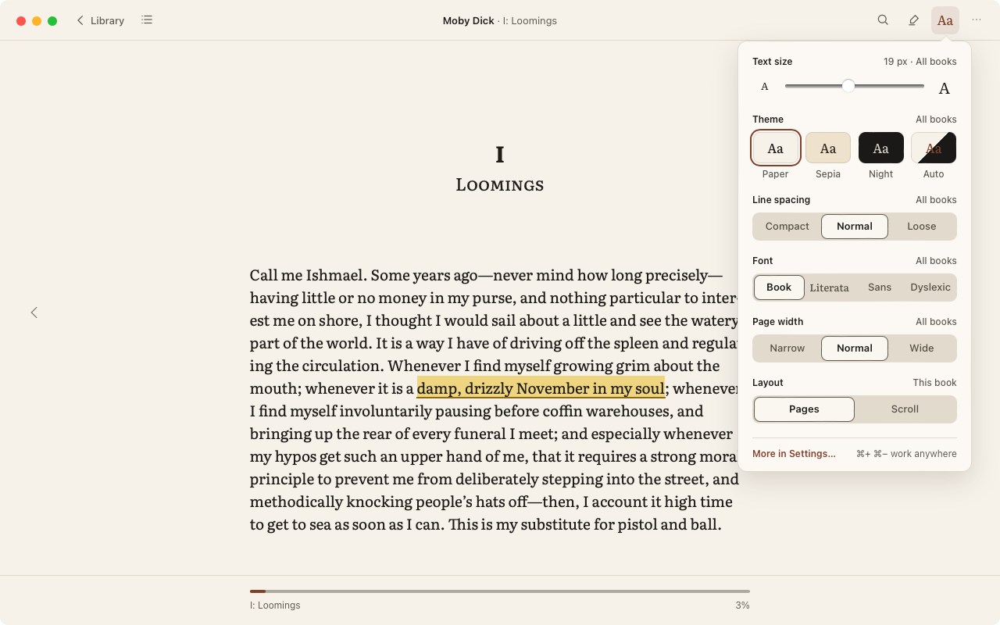
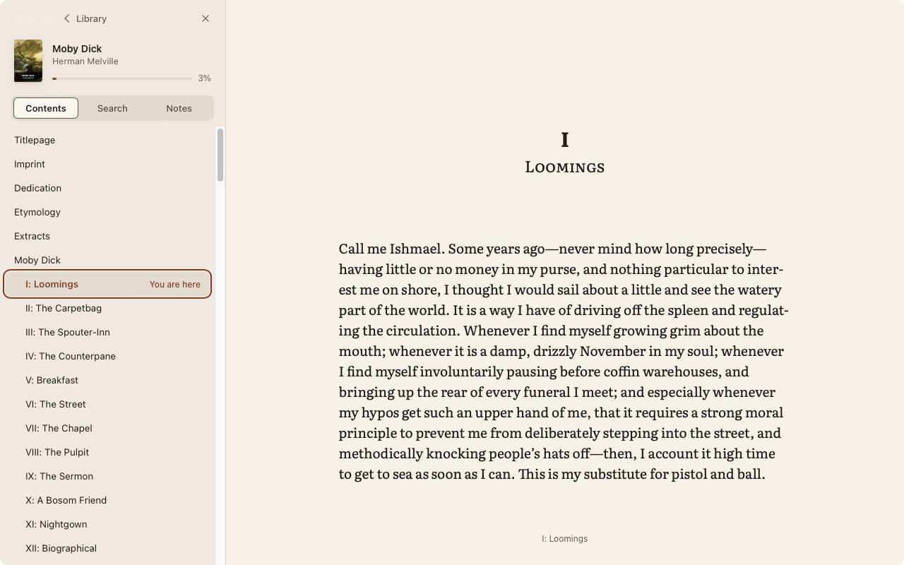
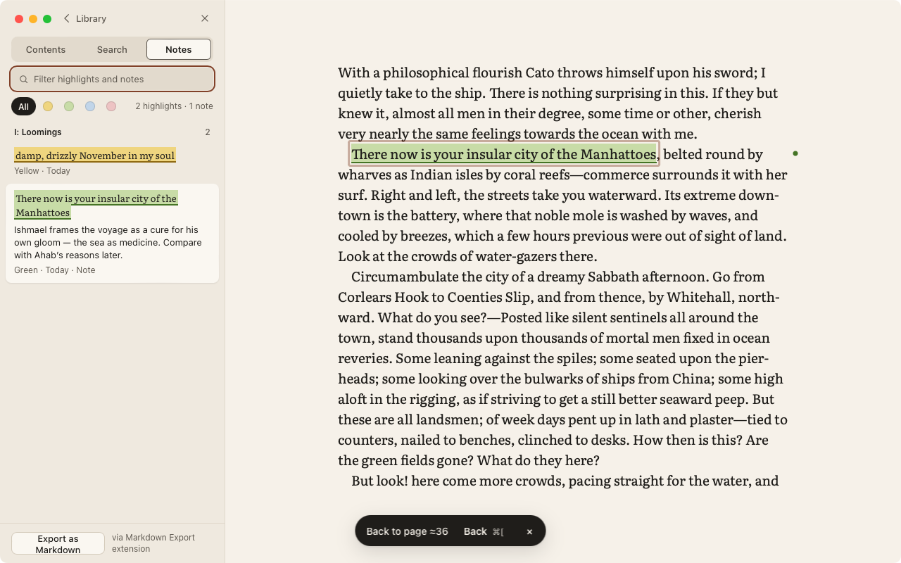
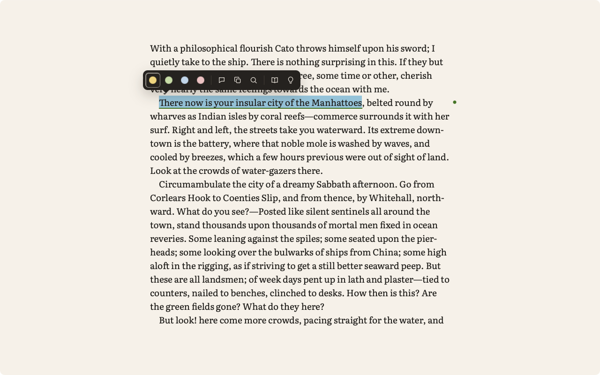
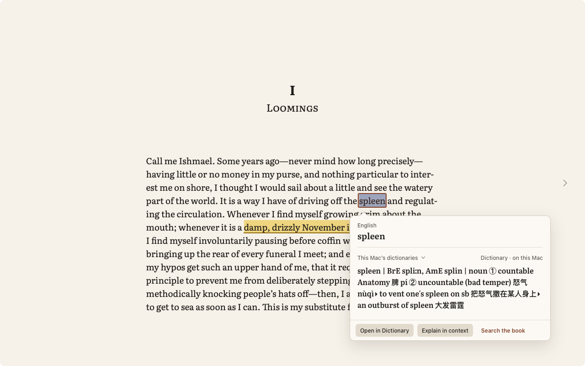
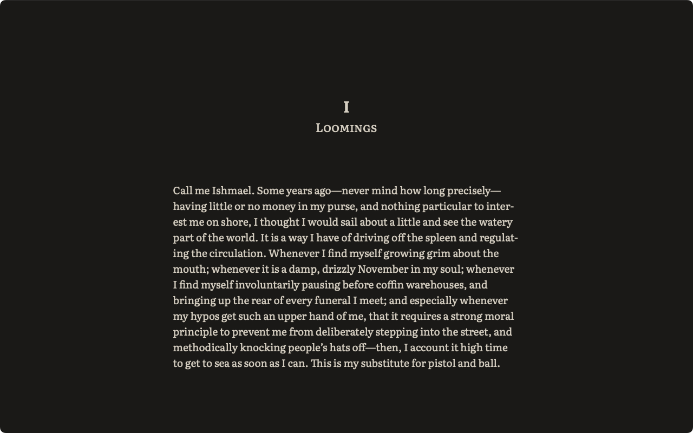

# Linen

[English](README.md) · [简体中文](README.zh-Hans.md) · [繁體中文](README.zh-Hant.md) · **日本語**

> このページは英語版 [README.md](README.md) の翻訳です。内容に違いがある場合は英語版が優先されます。

Linen は、macOS 用の静かな EPUB リーダーです。本の邪魔をしません。本文がウインドウいっぱいに広がり、操作部品は必要なときにだけ現れ、読んでいる内容が Mac の外に出ることはありません。Tauri 2（Rust コア）、Svelte 5、foliate-js で作られた、MIT ライセンスのオープンソースソフトウェアです。



- **好きなように読める。** ページ表示とスクロール表示、広いウインドウでの見開き、右から左への横書きと縦書き、ズームできる固定レイアウトのブック。文字サイズ、行間、フォント（OpenDyslexic を含む）、ページ幅、そして 3 つのテーマ（ペーパー、セピア、ナイト）を選べます。
- **迷わない。** 目次、ブック内の検索、パーセント・章・紙の本のページへの移動、ポップアップで開く注、そしてジャンプのあとはいつでも戻れます。
- **ハイライトとメモ** は 4 色。「メモ」タブにまとまり、Markdown や W3C Web Annotation として書き出せます。
- **調べる**：Mac の辞書や自分の MDX 辞書で、ページを離れずに単語を調べられます。
- **キーボード優先。** すべてのコマンドはコマンドパレット（⌘K）にあり、どのショートカットも変更できます。
- **機能拡張** でコマンド、選択テキストへの操作、ナビゲータのタブ、テーマ、書き出し形式を追加できます。機能拡張はそれぞれ専用のサンドボックスで動き、許可したアクセス権だけを持ちます。
- **5 つの言語：** 英語、簡体字中国語、繁体字中国語、日本語、スペイン語。VoiceOver ですべてを読み上げられます。

| 目次                                                       | ハイライトとメモ                                           |
| ---------------------------------------------------------- | ---------------------------------------------------------- |
|                 |                          |
| **選択バー**                                               | **調べる**                                                 |
|  |  |

## 読者向けガイド

### インストール

1. **macOS 13 以降と、Safari 16.4 以降** が必要です。Linen は Safari に含まれるシステムの WebKit でブックを表示します。WebKit が古い場合、Linen はブックを開く代わりにその旨を伝え、ソフトウェアアップデートを案内します。
2. [最新のリリース](https://github.com/Quentinbest/read-book/releases/latest)から DMG をダウンロードします。Apple シリコンの Mac は `aarch64`、Intel プロセッサの Mac は `x64` です。DMG を開き、Linen を「アプリケーション」フォルダにドラッグします。
3. **初めて開くとき。** Linen はまだ Apple Developer ID で署名されていないため、開く前に macOS が確認します。Control キーを押しながら Linen をクリックして「開く」を選び、もう一度「開く」をクリックします。または一度開いてから、「システム設定 › プライバシーとセキュリティ」で「このまま開く」を選びます。

Linen は 1 日に 1 回アップデートを確認し、署名されたアップデートを自動でインストールします。各バージョンの変更点は [`CHANGELOG.md`](CHANGELOG.md)（英語）にあります。

### 最初の 1 冊

1. **ブックを追加する。** EPUB ファイルをライブラリにドロップするか、「開く…」（⌘O）を選ぶか、Finder で EPUB をダブルクリックします。Linen は各ブックをライブラリにコピーします。
2. **読む。** 表紙をクリックするか、「続きから読む」で前回のブックを開きます。→ と ←、スペースバー、Page Down、またはトラックパッドでページをめくります。ポインタをウインドウの上端か下端に動かすとツールバーが表示されます。⌘L でライブラリに戻ります。
3. **自分好みにする。** **Aa** をクリックすると、文字サイズ、テーマ、行間、フォント、ページ幅、ページ表示とスクロール表示を設定できます。⌘+ と ⌘− はどこでも文字サイズを変えられます。
4. **迷わない。** ⌘T で目次、⌘F でブック内を検索、⌘J でページ・章・パーセントへ移動し、ジャンプのあとは ⌘[ で戻ります。
5. **ハイライトする。** テキストを選択すると、選択バーに 4 色、メモ、コピー、検索、調べるが表示されます。テキストを選択した状態で H を押すとハイライト、N を押すとメモを追加します。⌘⇧A で「メモ」タブを開き、絞り込みや書き出しができます。
6. **単語を調べる。** 単語を選択して ⌃⌘D を押します。自分の辞書を使うには、「設定 › 辞書」で MDX ファイルを追加します。
7. **そのほかのすべて** はコマンドパレット（⌘K）にあります。? を押すとショートカットの一覧が表示され、「設定 › ショートカット」でどのショートカットも変更できます。

**言語。** Linen は Mac の優先する言語に従います。別の言語にするには「設定 › 一般 › 言語」で選びます。Linen を再起動すると反映されます。

### ライブラリ

- **場所。** すべては 1 つのフォルダ `~/Library/Application Support/app.linen.reader` にあります。データベース（読んでいる位置、ハイライト、メモ、設定）、ブック、表紙、機能拡張とそのデータです。「設定 › ライブラリ › Finder に表示」で開けます。
- **バックアップ。** このフォルダをバックアップします。Time Machine ならすでにバックアップされています。
- **復元。** このフォルダを（この Mac でもほかの Mac でも）元の場所に戻してから Linen を開きます。
- **書き出し。** 「設定 › ライブラリ › すべてのハイライトとメモを書き出す…」で、ブックごとに W3C Web Annotation ファイルを 1 つ書き出します。ほかのアプリでも読み込めます。
- **アンインストール。** Linen をゴミ箱に入れても、このフォルダは残ります。すべて削除するには、このフォルダと `~/Library/Logs/app.linen.reader` も削除してください。

### プライバシー

Linen はどこにも何も送信しません。問題が起きたときは、詳細がこの Mac 上のクラッシュログ（`~/Library/Logs/app.linen.reader/crash.log`）にだけ記録されます。「設定 › 情報」から表示でき、メールに添付するかどうかはあなたが決められます。機能拡張がネットワークに接続できるのは、自分で宣言したホストに対して、あなたが許可したあとだけです。



## 開発者向けガイド

### 準備

Xcode コマンドラインツール、[Rust](https://rustup.rs)（stable）、Node.js 24、pnpm を入れた Mac が必要です（`corepack enable` で `package.json` に指定されたバージョンが使われます）。

```sh
git clone https://github.com/Quentinbest/read-book.git
cd read-book
pnpm install        # patches/foliate-js@0.0.0.patch も適用されます
pnpm tauri dev      # アプリを起動
```

### コードの構成

| 場所                       | 内容                                                                                                    |
| -------------------------- | ------------------------------------------------------------------------------------------------------- |
| `src-tauri/src`            | Rust コア：IPC コマンド、SQLite ストア、読み込みと EPUB の検証、機能拡張のレジストリ、AppKit 連携。     |
| `src/reader/engine.ts`     | `ReaderEngine`。foliate-js を包む唯一のアダプタ：ページ、スクロール、横スクロール、固定レイアウト。     |
| `src/reader/Reader.svelte` | リーダーの画面とそのコマンド。                                                                          |
| `src/lib/commands/`        | すべてのコマンドを 1 回だけ宣言する場所。メニューバー、⌘K、ショートカット一覧はここから作られます。     |
| `src/lib/strings/`         | 画面のテキストすべて。言語ごとに 1 ファイル。共通の用語は `docs/i18n/glossary.md` にあります。          |
| `src/extensions/`          | 機能拡張のホスト。API リファレンスは [`docs/extensions/README.md`](docs/extensions/README.md)（英語）。 |
| `docs/`                    | 実装計画、デザイン、決定事項、進捗。コードのコメントは計画のルール ID（`// B8: …`）を引用します。       |

### 最初の変更

1. `main` からブランチを作って変更し、そのそばにテストを追加します（Vitest は `src/**/*.test.ts`、Rust は `#[cfg(test)]` モジュール）。
2. CI と同じチェックを実行します。警告が 1 つでもあると CI は失敗します。

   ```sh
   scripts/ci-local.sh          # フォーマット、lint、型、単体テスト、デザイントークン、cargo fmt、clippy、cargo test
   scripts/ci-local.sh --full   # Playwright のテストも実行
   pnpm vitest run src/reader/layout.test.ts    # テストファイル 1 つだけ
   ```

3. プルリクエストを作成します。CI が通ってからマージされます。

### 機能拡張を書く

機能拡張は `*.linenext` という名前の zip で、`manifest.json`、worker スクリプト、必要に応じてページを含みます。[`examples/extensions`](examples/extensions) のサンプル（辞書と Night Owl テーマ）から始め、[`docs/extensions/README.md`](docs/extensions/README.md) を読み、「設定 › 機能拡張 › ファイルからインストール…」でインストールします。

### 実際のアプリでテストする

macOS には Tauri 用の WebDriver がないため、アプリはテストビルドで独自のエンドツーエンドテストを実行します。

```sh
LINEN_SPIKES=1 pnpm tauri build --no-bundle --features spikes \
  --config src-tauri/tauri.spikes.conf.json           # テストビルド
scripts/e2e.sh                                        # アプリ内テスト一式（約 30 分）
scripts/e2e.sh r '^(N3-bodymatter|B8)'                # ID が一致するチェックだけ
scripts/e2e.sh v && node tests/visual/compare.mjs     # キャプチャを承認済みの基準画像と比較
python3 scripts/perf-coldstart.py; scripts/perf-memory.sh   # 性能予算（§6.4）
(cd src-tauri && cargo test --features spikes)        # Rust（テスト専用コードを含む）
```

テストは現在のデスクトップで実行され、実行中はディスプレイをスリープさせません。`LINEN_SPACE=2 scripts/e2e.sh` ではウインドウをデスクトップ 2 に移して実行します。Rust のコーパステストは、`python3 scripts/corpus/fetch.py` と `python3 scripts/corpus/generate.py` でテスト用のブックを用意するまで自動的にスキップされます。

### ビルドとリリース

```sh
scripts/release-macos.sh --unsigned # 開発用の DMG
scripts/release-macos.sh            # 署名と公証あり（スクリプトに示された資格情報が必要）
```

- **リリース。** `src-tauri/tauri.conf.json` と `src-tauri/Cargo.toml` の `version` を上げ、[`CHANGELOG.md`](CHANGELOG.md) にそのバージョンの概要を追加してから、対応する `vX.Y.Z` タグをプッシュします。`.github/workflows/release.yml` が、その概要、Apple シリコン用と Intel 用の DMG、署名済みのアップデートアーカイブ、`latest.json` を含む GitHub Release の下書きを作ります。下書きを公開するとリリースされます。Apple Developer ID を取得するまでは、ビルドはアドホック署名です。
- **アップデートの鍵** は、リリース用 Mac の `~/.tauri/linen-updater.key`（と `.password`）と、リポジトリのシークレット `TAURI_SIGNING_PRIVATE_KEY` と `TAURI_SIGNING_PRIVATE_KEY_PASSWORD` にあります。必ずバックアップしてください。鍵がないと、インストール済みのアプリを更新できなくなります。決してコミットしないでください。

## ライセンス

[MIT](LICENSE)。スクリーンショットのブックはハーマン・メルヴィルの『白鯨』で、パブリックドメインです。
